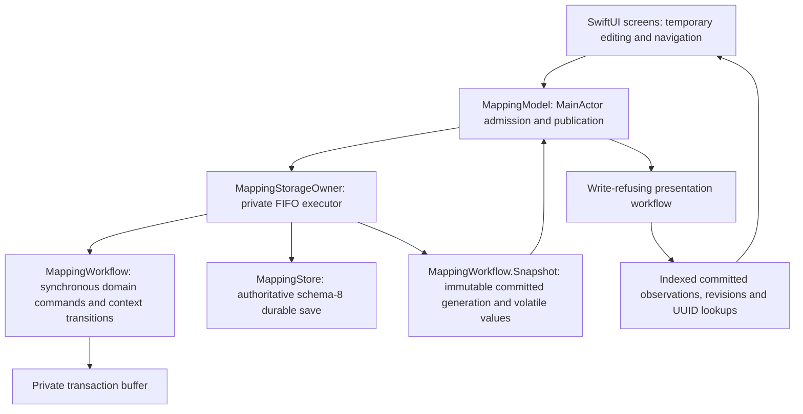
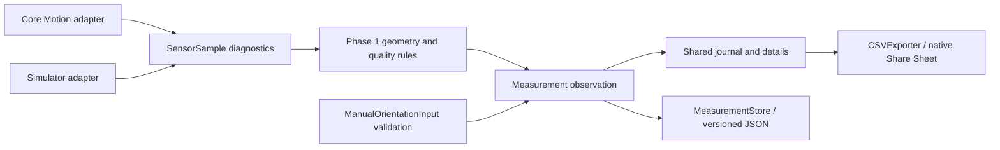

# Architecture foundation (Phase 2)

## B1a/B1b complete offline backup and verified restore

[Format 1 and consistency contract](backup-format-v1.md): the existing mapping FIFO owner reserves a committed generation and streams all durable originals/recovery files into temporary staging. The independent measurement store adds only synchronous access exclusion and read-only deployed-version inspection; its compatibility/save behavior stays intact. `OfflineBackup` uses the existing ZIP writer, and `BackupValidator` checks the generated ZIP without extraction or activation. Complete/incomplete status is independently derived from authoritative schema-8 graph validation, inventory hashes, UUID links, independent-journal coverage and pending operations. Hashing, ZIP writing and verification stay off MainActor. B1b adds `OfflineRestore` and `ApplicationSession`: private extraction and exact revalidation, a verified B1a pre-restore ZIP, durable intent outside the live root, two guarded directory renames and deterministic startup rollback. The previous directory remains intact. The retired FIFO owner rejects stale callbacks; the independent file lock/write epoch excludes stale writers. Startup recovery precedes either store, and replacing the whole model/navigation generation prevents stale editors from overwriting restored data. Mapping schema 8 and deployed independent compatibility stay intact; restored legacy bytes use read-only compatibility loads. No primary tab is added. See the [activation and recovery protocol](backup-format-v1.md#durable-activation-protocol).

Current enterprise geotechnical extension: see [versioned SD, ROCK, field strength, JCond76, categorical GSI and three-sheet workbook](enterprise-geotechnical.md). Optional fields extend the shared schema-8 graph; no migration/reset or original-measurement journal change.

## Final field polish

[Current contract](final-field-polish.md): `RMR89Basic.swift` is a Foundation-only category evaluator. Optional `RMR89Input.basicSelections` and `RMR89Assessment.calculation` add the exact `Bieniawski-RMR89/basic-categories-v1` method; input-only-v1 records retain their old validation. New result, component ratings and missing lists are revalidated against exact input/method. Schema remains 8, with no mapping migration/reset or standalone-measurement changes.

`MappingCSVExport.prepare` freezes five field sheets and a `field_links` sheet with the same effective observations, period and context as its existing technical tables. `MappingFieldWorkbook` uses typed domain values, never parses CSV, and never evaluates ratings. XLSX/2 emits field sheets first, numeric field values/civil dates, and the preserved exact technical contract with hidden-by-default technical tabs. The share controller receives one URL for ordinary Excel. CSV and photo packages remain explicit advanced operations. `LosslessNumericField` is a UIKit presentation adapter for coordinates/axis: native begin/end editing callbacks swap display/raw text, and only editingChanged writes domain input. Wedges keyboard dismissal uses a reserved full-width safe-area bar, not an overlay over fields.

## Third iPhone review contract

[Third iPhone review](third-iphone-review.md) supersedes earlier capture/plan presentation: immutable editor and coordinate-selection requests, decimal canonical pickets with exact historical validation, owner-defined Q presentation, and qualified cross-revision overlays. Schema stays 8; the optional plan `frameConfirmation` records a predecessor UUID/time at import, with units/frame/axes, relationship, cycle and transitive-conflict validation. Missing declarations imply no confirmation. Original plans/coordinates/evidence and correction history remain immutable; no migration, reset or coordinate transformation is introduced.

## Second iPhone field workflow update

[Second iPhone review](second-iphone-review.md) documents compatible excavation selection, volatile draft parking, isolated modal sensor sessions, tagged 10 m picket capture with legacy validation, and versioned Q numerical/documentation separation. Mapping stays on schema 8 with no migration/reset; original measurements, attachment bytes, source plans and correction history remain protected. Device crash root cause and physical qualification remain open. This current contract supersedes conflicting historical workflow descriptions below.

## Field UI refinement (#38, #48–53)

The [field interaction contract](field-ui-refinement.md) updates presentation without changing mapping schema 8, original-measurement compatibility, engineering algorithms or export serialization. `EngineeringDisplay` is a Foundation-only output formatter. `MappingModel` owns disposable active-plan preferences keyed by project/horizon UUID in UserDefaults; journal append order is the labelled default until a valid revision is chosen. A stale selection falls back for display with a visible warning and does not rewrite preferences or engineering records. `ActiveHorizonPlanView` replaces the Plan file-list root and resets loader/view identity on horizon or plan changes. Display revision choices never update `MappingDraft.planID` or saved coordinates.

`MappingJointSetsSection` uses the existing `JointSetDraft` and `MappingDraft` graph. Its local sheet stages accepted originals and representative values; explicit acceptance publishes both to the live point draft, while the existing point save remains the persistence boundary. Manual originals retain entered text; iPhone originals retain full sensor snapshots. Unavailable/DEMO north and ambiguous partial sensor planes cannot be silently converted to a supported representative; savable held originals can be explicitly retained without assigning a J system. Parent application validates a copied draft before publishing evidence and interpretation together. Manual modifications of a sensor-derived representative remain interpretations and retain a visible manual-edit badge without fabricating compass evidence. Existing correction editors retain read-only original evidence and full geology fields. No second database or persisted interpretation format is added.

**P5.1 implemented:** [Mapping CSV analysis export](p5-1-mapping-csv.md) uses `MappingExportSelection`, a value-owned `MappingCSVExport` preview and `MappingExportFiles`. The Russian export screen holds a saved-journal snapshot independently of `MappingModel`/capture drafts. Detached preparation and file writing propagate cancellation; the native share presentation owns temporary files until dismissal. No database/geometry/attachment source writes or runtime dependencies are added. The 14 related tables use latest effective points, original evidence, stored assessments and explicit historical photo contexts, with a separate export-format version.

**P5.2 implemented:** [Offline XLSX](p5-2-mapping-xlsx.md) consumes those same typed `MappingCSVExport` values. `MappingXLSXExport` supplies summary, typed cells, precision protection and worksheet styles; `XLSXArchive` streams internally named OOXML parts into an export-owned ZIP32 file using Foundation. Format selection changes only serialization, with no second filtering engine, source-file access or persistence dependency.

**Pre-MVP owner storage decision:** mapping uses only current experimental schema **8**. No automatic mapping migrations, new `.pN-backup`, resets or deletions; old/corrupt files fail closed and all existing files are preserved. Earlier mapping-schema descriptions below are historical, not supported compatibility. Atomic current saves/`.previous`, integrity, external-change guards and immutable evidence/history remain. The independent original-measurement journal keeps its deployed compatibility. See [current storage/recovery](p4-1-photos.md) and [AGENTS.md](../AGENTS.md).

**P4 implementation update:** [Saved-point photographs](p4-1-photos.md) and [new-observation draft photos](p4-2-draft-photos.md) supersede future-only photo statements below. Draft photos commit atomically with their first point and retain unknown capture-location provenance. Saved-point imports retain exact P3.3 point revisions. Point-free photos, XLSX/ZIP packages and automatic backup/restore remain future work. JSON alone is not a complete backup; include original photographs, DXF, pending operations and a verified inventory/manifest.

**P2 update:** [P2 mapping and DXF contract](p2-dxf.md) supersedes historical P1 statements about optional horizon elevations, mandatory per-point coordinate strings, absent plans and schema 1. P2 adds nominal Z provenance and immutable managed DXF revisions on the same graph; orientation/measurement conventions are unchanged.

**P1 implementation update:** [Mapping workflow and persistence](p1-mapping.md) describes the implemented project/horizon/multi-horizon-excavation/point graph, context/draft state machine, atomic JSON decision, immutable observations and protected legacy inbox. The Phase 2 descriptions and larger future schema below are historical/design context; they do not override P1's implemented scope.

## A6 repository and presentation contracts

[A6](architecture-a6.md) pairs a saved `MappingJournal` and its disposable read
indexes in one immutable, checked-Sendable `MappingCommittedSnapshot`.
`MappingWorkflow.Snapshot` transfers that generation together with volatile draft,
parked-draft and pending-context values. The existing storage owner rebases both
journal and indexes, and MainActor publication shares the generation only after the
whole transaction succeeds. Draft changes never rebuild or modify committed data;
successful journal changes replace the generation, including corrections and context
or plan management. Failed commands retain the prior generation.

The existing `MappingStore` protocol remains the synchronous persistence boundary;
production screens need no additional `ProjectRepository` protocol or persistence
coordinator. `MappingWorkflow` owns domain commands on the FIFO executor and
admitted volatile edits on MainActor; it never runs concurrently as a shared mutable
object. Read indexes are built off main in production workflow load/commit, retained
with their exact journal, and excluded from Codable/schema 8. Journal filters,
per-plan overlays and Wedges sources are computed once per body evaluation from
that generation; inexpensive screen controls remain local. Export retains its own
committed generation at opening. Full history and export serialization keep their
existing domain APIs. Engineering services remain Foundation-only.

## A4 off-main serialized storage

[The A4 contract](storage-concurrency-a4.md) supersedes synchronous mapping storage
ownership in historical sections. `MappingModel` remains on MainActor;
`MappingStorageOwner` serializes non-suspending buffered commands, authoritative
schema-8 validation, exact backup/atomic writes and attachment mutations on a private
FIFO queue. Each admitted operation has a UUID and a committed/failed reconciliation
that survives caller cancellation. Conflicting UI commands are temporarily disabled
or explicitly refused, preserving drafts and prepared intents. Exports retain the
last committed value captured at export-screen opening. No stored format, engineering
calculation or independent measurement-journal behavior changes.

[A5](swift6-concurrency-a5.md) makes this boundary explicit: only
`MappingWorkflow.Snapshot` values cross the queue boundary. The owner retains the
working store privately; published workflows use a write-refusing presentation
store. Transaction results must be Sendable. Photo failure hooks use a system lock;
original/thumbnail/manifest mutations still use the same storage queue.

## A3 mapping validation and storage performance

Schema 8 still uses full authoritative validation on load and every save. One
validation pass builds transient project/horizon/excavation/plan indexes, validates
the original graph once, then checks every historical snapshot through the same
observation validator. Revision lookup uses an original UUID map; the existing
chain, geological ownership and latest-interpretation maps retain ordered history
and cross-point/cross-kind protection. Exact original context, evidence links and
creation timestamps must match before validating a snapshot. Global measurement
membership cannot change through a correction; geological UUID ownership plus
local snapshot uniqueness replaces repeated global uniqueness scans.

Append-only storage checks index each current evidence table by UUID and compare
complete prior records, including original measurements, observation revisions,
photos, attachments and photo metadata revisions. Plan/lithology retention checks,
previous-byte decoding, encoded round-trip equality, both external-change guards,
atomic writes and exact `.previous` handling remain in place. Indexes live only
for their call; no cache, new persistence layer, schema or JSON field is added.
Single effective lookup searches backward for its latest revision without
allocating a filtered history. Bulk resolution already uses a local O(N+R) map;
full history remains ordered in journal order. See the [A3 measurements and
limits](storage-performance-a3.md) and [A2 baseline](storage-performance-baseline.md).

## P3.3 implemented observation revisions

[Saved observation corrections](p3-3-revisions.md) extends the same JSON aggregate to schema 6 with `MappingObservationRevision` snapshots. `observations` and `measurements` remain append-only originals. Each correction has a stable observation FK, unique revision UUID, sequential version starting at 2, predecessor UUID, exact correction instant, optional manual author and required reason. `MappingCorrectionDraft` freezes the current baseline and evidence; `saveCorrection` validates and commits before publishing. `effectiveObservations` supplies one snapshot per original UUID to journal queries, details and DXF overlays. Unchanged interpretation/assessment metadata is retained; changed J sets increment their local revision and Q uses the frozen NGI 2025 implementation. Historical snapshots keep exact input/evidence/plan references. There is no project reassignment or raw evidence editing.

## P3.2b classification implementation

[Rock-mass assessments](p3-2b-ratings.md) adds Foundation-only versioned Q tables/evaluation and input-only RMR89 in `Data/Models/RockMassRatings.swift`. SwiftUI is an adapter to shared input values and stored snapshots; no sensor, DXF or geometry dependency is introduced. Point-level ratings use the existing atomic `MappingWorkflow.save`, schema-5 graph validation, backup/migration and append-only observation contract. Persisted Q results must match the exact method and original input; RMR numerical ratings remain unavailable.

## Product boundaries

The authoritative [product vision](product-vision.md) defines exactly three primary modules: **Geomechanical Mapping**, **Excavation Plans & Spatial Positioning**, and **Wedge Analysis**. All use one consistent offline project database, stable IDs and common engineering services. Measurement, exports and backups serve those modules rather than becoming independent products. Current Phase 2 functionality below is unchanged; the following future service boundaries do not implement additional features.

## Current implementation

FieldForge is a native Swift/SwiftUI, iOS 17+, Russian-language, offline application. It has no runtime third-party dependency, backend, account, or network requirement. `AppModel` composes a sensor provider, HOLD session, manual draft, shared journal store, and export service on the main actor.

- `Core/Geometry`: Foundation-only vectors, orientation values, north and direction conventions. No Core Motion or UI dependency. Phase 1 geometry remains unchanged.
- `Core/Sensors`: immutable-by-snapshot diagnostic values and adapters. Core Motion retains its 20 Hz acquisition, magnetic calibration/field guards, motion checks, generation tokens, and freshness watchdog.
- `Data/Models`: provenance-aware `Measurement`, manual input validation, and sensor HOLD state. Manual observations do not pass through `MeasurementSession` or invent samples.
- `Data/Storage`: explicit v1 reader, v2 envelope, record validation, non-overwriting legacy backup, atomic replacement, and write protection.
- `Services/Export`: CSV transport encoding separated from UI formatting.
- `Features`: SwiftUI presentation with Russian labels. Both sources use the same journal and exporter.

`Measurement` is an original orientation observation, not a statistical joint set. Its `PlaneOrientation` has no sensor dependency. The optional `sample` contains diagnostics only when the source is `iPhoneSensor` or `simulatorMock`; validation requires a consistent source/sample pair. Manual records require validated original input, `manualUnverified` quality, and `manual-entry-v1`. Unsupported external-instrument records cannot yet be saved. North metadata and user notes belong to the observation, not to Core Motion.

Manual input is validated continuously; SAVE is enabled only for valid input and writable storage. Saving the same draft twice is disabled. Editing creates a new unsaved draft; «Новое измерение» clears it explicitly. Each capture gets a UUID; the store rejects duplicate UUIDs, while repeated observations of the same angle remain legitimate. Switching to manual stops acquisition and preserves any sensor HOLD snapshot; returning to automatic resumes the existing HOLD workflow. Background/tab lifecycle rules still apply.

## Future domain boundaries

The [domain schema](data-model.md) defines projects, excavations, intervals, rock-mass assessments, interpretations, original measurements, prepared plans/locations, and versioned analysis inputs/results. These are a design contract, not implemented screens or database entities in Phase 2. Add capabilities when their workflow is ready, rather than implementing a generic framework now.

Future services should accept domain values/IDs: classification services consume versioned interval assessment inputs, interpretation services create explicit joint-set representatives with links to originals, spatial services resolve manually selected plan/alignment positions into declared model coordinate systems, and exporters read a consistent repository snapshot. None should mutate original observation values as a side effect. Original evidence uses controlled correction revisions; representative orientations, location transforms and analysis results reference exact input versions.

| Primary module | Future service boundary / shared data |
| --- | --- |
| Geomechanical Mapping | Interval capture, original observations, explicit interpretations and versioned Q/RMR characterization |
| Excavation Plans & Spatial Positioning | Prepared PDF/raster/DXF-derived assets, surveyed controls, georeferencing revisions, manual X/Y/Z and chainage selection, provenance-aware location records |
| Wedge Analysis | Input selection by excavation/interval and joint-set revision IDs, separate geometric/kinematic candidates and mechanical assessment, local candidate visualization |

Photo documentation is a core shared capability of Mapping and Plan, not another module. `SpatialObservationPoint` supplies named field context and versioned location provenance; `PhotoObservation` links that context and optional geological evidence to managed `Attachment` UUIDs. Plan and interval galleries open the same records. The shared domain/storage/export services apply to iPhone and future iPad; camera/library availability and adaptive viewing remain UI/platform adapters.

Plan location selection opens the same mapping interval by ID. Wedge input assembly reads its saved excavation geometry and interpreted sets, reports missing values and records overrides as analysis-specific inputs; it never creates another measurement journal. A 2D plan point does not imply elevation or automatic underground position. Spatial services preserve CRS/units/axes, alignment version and chainage origin/direction.

### Wedge service separation (future)

Keep geometric/kinematic candidate generation independent of mechanical assessment. Geometry consumes explicitly versioned excavation surfaces and discontinuity inputs, reports intersections/configurations and missing bounds or release assumptions, and may return indeterminate/unbounded results. Visualization consumes that geometry; it does not decide stability. Joint orientations alone are insufficient to assert finite wedge volume.

Mechanical assessment consumes a geometry result plus a separately validated mechanical input snapshot. Cohesion and friction angle are planned inputs, with units/source and unknown states; any other parameter must be justified by the selected method. **Owner-provided formulas/methodology, verified published references and independent engineering cases/tests are required before implementing mechanics.** No arbitrary friction rules, stable/unstable labels, factors of safety or risk thresholds may be inferred from geometry. Persist geometric and mechanical method/implementation versions separately, including an explicit unavailable mechanical result. No wedge engine is added in this PR.

### Native iPhone / future iPad codebase

Share domain models, repository/database design, capability-checked measurement providers, validation, geometry, future wedge services and import/export. A shared database design does not imply device synchronization. Keep selected project/interval, capture state and engineering computations separate from device-specific layouts. Use size classes/window size, reusable SwiftUI components and `NavigationSplitView` where appropriate: compact one-handed iPhone capture versus iPad sidebar/split-view plan/forms, expanded candidate views and optional Pencil annotation. Do not assume identical sensor capabilities or stretch the phone layout. No iPad target, deployment change or current TabView redesign is introduced here.

Local plan and wedge display are the spatial UI priorities. Complete CAD/DWG editing, general-purpose GIS, full 3D geological/mine modeling and numerical geomechanical simulation remain outside scope. Large imported meshes are optional extensions, not a prerequisite for the three modules; see [import/export](import-export.md).

## Persistence decision and migration path

Keep the current `MeasurementStore` and JSON journal for this phase. Whole-file rewrite and in-memory lists are reasonable at prototype scale, but unsuitable for projects with thousands of intervals, photographs, and geometry. Do not store image/mesh bytes inline in record JSON.

| Option | Strengths | Constraints for FieldForge |
| --- | --- | --- |
| SwiftData (iOS 17+) | Native Swift relationship/query integration, minimal setup | Migration behavior and store portability need qualification; framework model coupling and backup recovery require care; no implicit cloud sync should be enabled |
| SQLite via system SQLite3 | Explicit foreign keys, indexed queries, transactions, versioned SQL migrations, portable inspectable backups | Requires typed mapping and disciplined connection/transaction ownership |
| JSON repository | Human-readable, simple, current deployed compatibility | Rewrites all records; no foreign keys or efficient interval queries; relationships must be validated manually |

**Recommend SQLite when the mapping workflow is implemented**, using the system library first and a small repository interface shaped by actual queries. Evaluate a maintained wrapper only if it demonstrably simplifies correctness. Do not add it in this PR. Use `PRAGMA foreign_keys=ON` on every connection, indexed parent IDs/chainage/timestamps, explicit schema history, transactional migrations, integrity checks, and a serialized writer. Keep query/DTO boundaries independent of SwiftUI and Core Motion. Prefer restrictive relationship deletion until the user explicitly chooses a reviewed cascade/archive operation.

Planned JSON → SQLite transition:

1. Read and validate the complete existing JSON through the current migration reader; retain original bytes and IDs.
2. Create a new staging database. Insert original observations and provenance in one transaction; standalone journal records have nullable interval links.
3. Verify counts, UUID sets, timestamps, exact orientation/diagnostic values, constraints, and export round trips. Do not infer project/interval membership.
4. Atomically promote the validated database with an explicit migration marker. Retain JSON and recovery instructions. Do not delete the only readable source.
5. Back up using SQLite's online backup API or a consistent closed snapshot, including attachments and a manifest. Never copy only the live WAL database file. Restore into staging and validate before activation.

Keep photos and large geometry in an application-managed attachment directory, referenced by UUID, content hash, size, media type, and relative path. Coordinate record/attachment transactions through staging and a manifest, recover interrupted imports, and garbage-collect only after reference checks. Backups must include all referenced attachments; XLSX/CSV are analysis outputs, not complete backups.

### Photo attachment lifecycle (future)

Capture from the camera or import from Photos/Files into private managed storage so later library changes do not break offline access. Freeze the selected project/excavation/interval/point context at operation start. A service validates format/size/dimensions, records timestamps/provenance, computes the original hash and creates thumbnail/display derivatives separately. Preserve the best available original bytes; document when an OS/provider supplies only a converted representation. UI names/descriptions never rename record identity or overwrite originals.

Filesystem and database operations are not one atomic transaction. Use a persisted operation manifest and staging: copy/validate/hash temporary bytes, promote them to UUID-based managed paths, then commit their attachment/photo links transactionally. On interruption, resume or quarantine staged/orphaned bytes, reconcile by operation ID/hash and record availability, and avoid duplicate photos on retry. A failed thumbnail operation is retryable without recapturing or losing the original. Retain missing/damaged references for explicit recovery; never silently remove a photo or substitute an unrelated file.

Protect originals referenced by observations, exports or backups; remove only confirmed unreferenced files after a recoverable archive/cleanup policy. Restore into staging, verify hashes and relationship completeness, then activate the validated database/attachment package through an explicit recovery marker, retaining the previous readable package until activation succeeds. A full backup contains all referenced original images and metadata; regenerate thumbnails when possible and report originals that cannot be restored. Future failure/restart tests must cover interrupted imports, disk-full writes, missing/corrupt originals, derivative regeneration and restore integrity before shipping the photo workflow.

Location revisions and personal image metadata are separate concerns: point-free/ungeoreferenced capture remains available, plan-derived coordinates retain their source, and EXIF GPS is never underground positioning. Keep originals private and apply an explicit export metadata profile; sanitized files are derived attachments with their own hash and lineage. Avoid loading full-resolution galleries at once: bounded thumbnail caches, background decoding and cancellation support both device families. See [photo export](import-export.md); no capture, photo schema or attachment service is implemented here.

See [current safe migration](persistence-migration.md), [coordinate systems](coordinate-systems.md), and [import/export boundaries](import-export.md).

## P3.1 acquisition and atomic point save

`MeasurementAcquisition` owns the single shared provider and HOLD session across automatic presentation, with explicit visibility/foreground control. Mapping capture appends validated originals into the in-memory workflow draft; only the point-level commit persists both point and original table in one schema-3 graph. Independent measurement storage remains separate for unassigned legacy observations. See [P3.1](p3-measurements.md) for lifecycle, ownership, compatibility and limits.

## P3.2a implementation update

The shared mapping aggregate now uses schema 4 with optional `MappingGeology` on immutable points: interval bounds/position, interpreted J1–J5 revision-1 records with point-local original-evidence UUID links, and arbitrary tectonic structures. Original measurements remain separate immutable evidence. The existing atomic aggregate and backup mechanism is extended without a new storage layer; legacy observations retain absent geology. See [P3.2a domain, units and persistence](p3-2a-geology.md). Planned relational entities elsewhere in this document remain future architecture.

## P6.1 transient AR distance boundary

Mapping presents `DistanceMeasurementSheet` without passing its draft/model. `DistanceSession` isolates ARKit from the Foundation-only `DistanceMeasurementController` and `DistanceMath`; `ARDistanceSession` adapts live scene depth or detected-plane raycasts and SceneKit visualization. Points exist only in one AR session's local metre coordinates. Lifecycle/tracking invalidation clears them; no mapping persistence or geological calculation consumes them. See [P6.1 API and validation contract](p6-1-ar-distance.md).

## W1 transient visualization boundary

`Core/Wedges/WedgeGeometry.swift` owns renderer-independent geometry, validation and orientation transforms. `Services/WedgeMappingSource.swift` reads shared draft/effective Mapping snapshots, retaining identity/provenance without write access. `Features/Wedges` adapts the existing magnetic sensor provider, P6.1 distance sheet and native SceneKit; all parameters remain view memory. No persisted analyses or mechanics. See [W1 geometry v1](w1-geometry.md).
