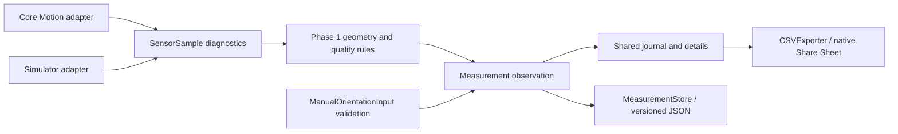

# Architecture foundation (Phase 2)

## Current implementation

FieldForge is a native Swift/SwiftUI, iOS 17+, Russian-language, offline application. It has no runtime third-party dependency, backend, account, or network requirement. `AppModel` composes a sensor provider, HOLD session, manual draft, shared journal store, and export service on the main actor.

- `Core/Geometry`: Foundation-only vectors, orientation values, north and direction conventions. No Core Motion or UI dependency. Phase 1 geometry remains unchanged.
- `Core/Sensors`: immutable-by-snapshot diagnostic values and adapters. Core Motion retains its 20 Hz acquisition, magnetic calibration/field guards, motion checks, generation tokens, and freshness watchdog.
- `Data/Models`: provenance-aware `Measurement`, manual input validation, and sensor HOLD state. Manual observations do not pass through `MeasurementSession` or invent samples.
- `Data/Storage`: explicit v1 reader, v2 envelope, record validation, non-overwriting legacy backup, atomic replacement, and write protection.
- `Services/Export`: CSV transport encoding separated from UI formatting.
- `Features`: SwiftUI presentation with Russian labels. Both sources use the same journal and exporter.

`Measurement` is an original orientation observation, not a statistical joint set. Its `PlaneOrientation` has no sensor dependency. The optional `sample` contains diagnostics only when the source is `iPhoneSensor` or `simulatorMock`; validation requires a consistent source/sample pair. Manual records require validated original input, `manualUnverified` quality, and `manual-entry-v1`. Unsupported external-instrument records cannot yet be saved. North metadata and user notes belong to the observation, not to Core Motion.

Manual input is validated continuously; SAVE is enabled only for valid input and writable storage. Saving the same draft twice is disabled. Editing creates a new unsaved draft; «Новое измерение» clears it explicitly. Each capture gets a UUID; the store rejects duplicate UUIDs, while repeated observations of the same angle remain legitimate. Switching to manual stops acquisition and preserves any sensor HOLD snapshot; returning to automatic resumes the existing HOLD workflow. Background/tab lifecycle rules still apply.

## Future domain boundaries

The [domain schema](data-model.md) defines projects, excavations, intervals, rock-mass assessments, interpretations, original measurements, and spatial references. These are a design contract, not implemented screens or database entities in Phase 2. Add capabilities when their workflow is ready, rather than implementing a generic framework now.

Future services should accept domain values/IDs: classification services consume versioned interval assessment inputs, interpretation services create explicit joint-set representatives with links to originals, spatial services resolve alignment positions into declared model coordinate systems, and exporters read a consistent repository snapshot. None should mutate original observation values as a side effect.

## Persistence decision and migration path

Keep the current `MeasurementStore` and JSON journal for this phase. Whole-file rewrite and in-memory lists are reasonable at prototype scale, but unsuitable for projects with thousands of intervals, photographs, and geometry. Do not store image/mesh bytes inline in record JSON.

| Option | Strengths | Constraints for FieldForge |
| --- | --- | --- |
| SwiftData (iOS 17+) | Native Swift relationship/query integration, minimal setup | Migration behavior and store portability need qualification; framework model coupling and backup recovery require care; no implicit cloud sync should be enabled |
| SQLite via system SQLite3 | Explicit foreign keys, indexed queries, transactions, versioned SQL migrations, portable inspectable backups | Requires typed mapping and disciplined connection/transaction ownership |
| JSON repository | Human-readable, simple, current deployed compatibility | Rewrites all records; no foreign keys or efficient interval queries; relationships must be validated manually |

**Recommend SQLite when the mapping workflow is implemented**, using the system library first and a small repository interface shaped by actual queries. Evaluate a maintained wrapper only if it demonstrably simplifies correctness. Do not add it in this PR. Use `PRAGMA foreign_keys=ON` on every connection, indexed parent IDs/chainage/timestamps, explicit schema history, transactional migrations, integrity checks, and a serialized writer. Keep query/DTO boundaries independent of SwiftUI and Core Motion. Prefer restrictive relationship deletion until the user explicitly chooses a reviewed cascade/archive operation.

Planned JSON → SQLite transition:

1. Read and validate the complete existing JSON through the current migration reader; retain original bytes and IDs.
2. Create a new staging database. Insert original observations and provenance in one transaction; standalone journal records have nullable interval links.
3. Verify counts, UUID sets, timestamps, exact orientation/diagnostic values, constraints, and export round trips. Do not infer project/interval membership.
4. Atomically promote the validated database with an explicit migration marker. Retain JSON and recovery instructions. Do not delete the only readable source.
5. Back up using SQLite's online backup API or a consistent closed snapshot, including attachments and a manifest. Never copy only the live WAL database file. Restore into staging and validate before activation.

Keep photos and large geometry in an application-managed attachment directory, referenced by UUID, content hash, size, media type, and relative path. Coordinate record/attachment transactions through staging and a manifest, recover interrupted imports, and garbage-collect only after reference checks. Backups must include all referenced attachments; XLSX/CSV are analysis outputs, not complete backups.

See [current safe migration](persistence-migration.md), [coordinate systems](coordinate-systems.md), and [import/export boundaries](import-export.md).
