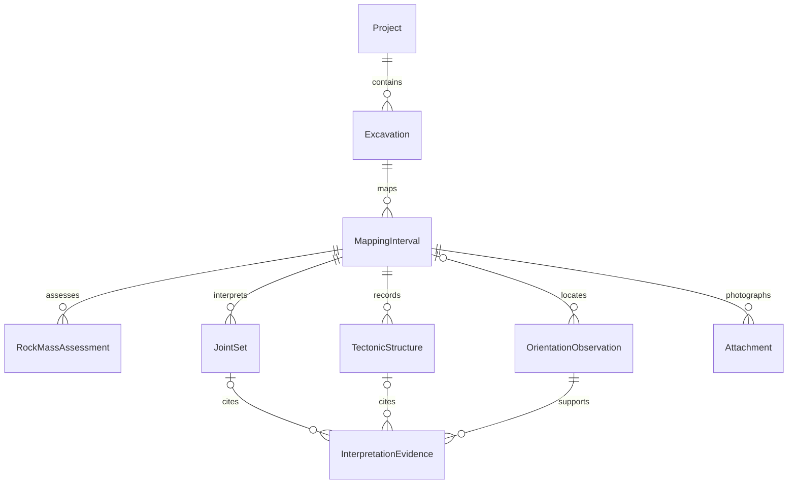

# Future geomechanical domain schema

This is the Phase 2 design for later implementation. Only original orientation observations and their safe persistence are implemented now. All entities use stable UUID primary keys, explicit foreign-key relationships, UTC instants, finite unrounded engineering numbers, and explicit units. Missing data is null with a reason, never an invented zero or rating. Distinguish original field inputs, calculated outputs, and interpreted representatives.

The [product vision](product-vision.md) is authoritative for requirements: this shared domain serves exactly Geomechanical Mapping, Excavation Plans & Spatial Positioning, and Wedge Analysis on iPhone and future native iPad. The planned records below are documentation, not changes to the deployed JSON schema.

## Project / mine

| Field | Type / meaning |
| --- | --- |
| `id` | UUID |
| `name`, `siteName` | Project and mine/site names |
| `crs` | CRS metadata: authority/code or WKT/version, datum/epoch where relevant, axis order, length units, vertical datum and north convention; explicitly unknown if not established |
| `mineCoordinateSystem` | Optional local origin, axes, handedness, length units, height definition and georeferencing transform with provenance/version; see coordinate document |

## Excavation

| Field | Type / meaning |
| --- | --- |
| `id`, `projectID` | UUID, required parent FK |
| `name` | Excavation name |
| `horizonName`, `elevationMeters` | Optional named horizon and numeric elevation with vertical-datum reference; a named horizon is not automatically a surveyed height |
| `type` | Versioned controlled type (e.g. drift, crosscut, shaft, open-pit exposure, other with description); no engineering rating implied |
| `surveyAlignmentID` | Optional spatial alignment FK including alignment version |

## Mapping interval

| Field | Type / meaning |
| --- | --- |
| `id`, `excavationID` | UUID, required parent FK |
| `startChainageMeters`, `endChainageMeters` | Finite numerical meters; end > start along the declared alignment direction |
| `observationPosition` | `leftWall`, `rightWall`, `roof`, `face`, `other`; other requires a description |
| `timestamp`, `description` | Observation instant and field description |
| `photoIDs` | Optional attachment relationships, not embedded binaries |
| `alignmentVersionID` | Optional snapshot reference preventing later survey edits from silently relocating observations |

Excavation name and horizon are presented through `excavationID` and the relevant parent revision rather than re-entered in each module. Planned location relationships below let the plan select this same interval and the wedge module consume its geometry/joint-set revisions.

Chainage is independent of strings such as «ПК 0+005». Define a display policy's picket length/precision and parse it explicitly if ever used for input. Typical interval lengths are 5–10 m; **no such length restriction is imposed**. Left/right follow increasing chainage, including explicit rules for branches/shafts; missing alignment leaves position unlocated rather than fabricating coordinates. Overlaps can be legitimate for different surfaces/dates; flag them for review instead of deduplicating by range.

Describe joint characteristics such as spacing, persistence, roughness, infill, weathering and water conditions primarily at interval level in field descriptions or later verified structured fields. Do not require separate entries for each representative orientation.

## Rock-mass assessment

`id` and required `mappingIntervalID`; assessments belong to an **interval**, never each individual joint measurement. Retain assessment revisions rather than overwrite field evidence.

- Q inputs: nullable `RQD`, `Jn`, `Jr`, `Ja`, `Jw`, `SRF`, each with original entry/value, units or dimensionless meaning, missing reason, source and observation notes. Preserve conflicting/incomplete inputs for review without calculating a class.
- Optional RMR assessment: selected published method/version/reference plus its original parameter inputs and evidence. RMR versions are not interchangeable; reserve a versioned parameter payload, without inventing rating tables.
- `method`, `classificationVersion`, bibliographic reference (edition/revision/page or table), assessor and timestamp.
- Separate nullable `calculatedResult`, result units/class, calculation implementation version/input snapshot, missing-data list and validation diagnostics.
- Optional interval field description.

**No Q or RMR calculation or empirical scale is implemented in Phase 2.** Future implementation must verify the specific publication/version and boundary cases. Candidate primary references for review: Barton, Lien & Lunde (1974), *Engineering classification of rock masses for the design of tunnel support*, Rock Mechanics 6, 189–236, DOI [10.1007/BF01239496](https://doi.org/10.1007/BF01239496); Bieniawski (1989), *Engineering Rock Mass Classifications*, Wiley. These citations do not authorize unverified transcription of scales or assuming all later Q/RMR revisions are equivalent.

## Representative joint sets

`id`, required `mappingIntervalID`, `identifier` in J1–J5; enforce uniqueness of `(mappingIntervalID, identifier)` and at most five representatives. Store representative dip angle, nullable dip direction, north reference and direction meaning. Include interpretation provenance: interpreter/time, selected method/reference/version if computed, rationale/notes, and optional links to multiple **original observations** through `InterpretationEvidence`.

A representative may be manually interpreted without constituent observations; that absence is explicit. Five measurements are not automatically five statistical sets. Editing a representative does not overwrite or relabel its original measurements. Do not average azimuths arithmetically or combine different north references without documented corrections. Uncertainty and sampling adequacy must be addressed before implementing statistical grouping.

An `InterpretationEvidence` record has its own UUID, a required `measurementID` FK and exactly one target FK (`jointSetID` or `tectonicStructureID`, enforced as an exclusive choice), plus role and interpretation provenance. The target and measurement must belong to the same interval when linked; an unassigned observation must be explicitly located before creating such evidence.

## Faults / tectonic structures

`id`, required `mappingIntervalID`, controlled `structureType` with an `other` description, nullable orientation fields when incomplete, `thicknessMeters`, `positionChainageMeters`, optional description and measurement/interpretation provenance. Thickness is finite and nonnegative when known; unknown is null. Store position as absolute chainage within the interval, with an optional explicit offset derived from its start; position must fall in the declared interval when known.

Allow multiple structures with **no arbitrary count limit**. Optional evidence links reference original orientations. A fault's interpreted orientation and an instrument observation remain distinct values. North/convention metadata travels with both.

## Original orientation observation

| Field | Type / meaning |
| --- | --- |
| `id`, `timestamp` | Stable capture UUID, observation instant |
| `dipAngleDegrees` | Finite 0–90° when known; Phase 2 saved observations require it |
| `dipDirectionDegrees` | Nullable; normalized [0,360)°, with original manual entry retained |
| `measurementSource` | `iPhoneSensor`, `manualCompass`, `externalInstrument`, `simulatorMock`; only the first, second and fourth currently supported |
| `referenceNorth` | Magnetic / true / grid / unknown; historical unavailable/simulated states retained explicitly |
| `directionMeaning` | Downhill / undefined / conventional vertical dip side |
| `sensorDiagnostics` | Optional sample (frame, matrix, quaternion, gravity, magnetic diagnostics, motion, uptime); absent for manual |
| `quality`, `uncertainty` | Explicit status; optional later physical uncertainty value/unit, method/confidence/reference. Absence is not zero uncertainty |
| `originalManualInput` | Optional original text, selected north and convention flag |
| `notes`, `plane`, `algorithmVersion` | Original notes and processing metadata; manual plane is geological, not iPhone screen |
| `mappingIntervalID` | Optional FK; deployed standalone journal observations remain valid |
| `relationship links` | Optional joint-set/tectonic evidence links; use join records with role/provenance rather than copy UUIDs into unstructured text |

For future partially mapped intervals, keep the interval, descriptions and incomplete structures even if there are no savable orientations. The current journal's stricter capture validation does not prescribe deleting incomplete future domain records. Record revisions/import lineage should preserve the original payload and author/time; deletion, correction and interpretation need explicit semantics.

## Prepared plans and location records (future)

| Planned record | Fields / relationships |
| --- | --- |
| `PlanAsset` | UUID, project FK, associated excavation IDs, source/format (PDF/raster/prepared DXF-derived geometry), attachment/hash, page/layer/geometry revision and original metadata |
| `SurveyControlPoint` | UUID, plan revision FK, source point/page coordinates and surveyed X/Y/Z as available, CRS/units/axes, survey source/version, quality and timestamp |
| `GeoreferencingRevision` | UUID, source plan revision, control-point revision IDs, source/target CRS, units/axes, transformation method/version/parameters, residuals, validity extent and author/time |
| `ObservationLocation` | UUID/revision, project/excavation FKs, interval or original-observation FK, optional plan mark/page, nullable X/Y/Z, CRS/units/axes, source/quality, survey/transform revision, optional chainage/alignment version and origin/direction |

Location derivation is explicit: surveyed, georeferenced-plan-derived, manually entered, or unknown. Record approximate quality independently, including source/uncertainty and missing-data reasons. Manual entry may cite surveyed coordinates; plan-derived does not mean independently surveyed. Ungeoreferenced plan marks retain their page/asset coordinates and unknown model position. A 2D plan does not supply Z by default. Unknown elevation must not become zero, a horizon label or a device altitude. The interval/observation target must be in the declared excavation/project; revision and evidence links prevent unrelated coordinate systems from being combined silently.

Control points, transformations and locations retain their original values and explicit revision history. A later plan/survey revision does not move existing evidence automatically. Selecting a saved plan location resolves the existing interval ID; it does not duplicate mapping data. No underground GPS/device-location inference is part of this model.

## Wedge inputs and derived results (future)

| Planned record | Fields / relationships |
| --- | --- |
| `ExcavationGeometryRevision` | UUID, excavation FK, axis azimuth/north and inclination convention, cross-section type/dimensions/units, surfaces/extent/position assumptions, optional survey/alignment revision and provenance |
| `JointMechanicalInput` | UUID/revision, representative joint-set revision or analysis-local plane FK, planned cohesion/friction values with units/source/reference, missing indicators and method-required additional inputs |
| `WedgeAnalysisRun` | UUID, project/excavation FK and optional interval FK, exact geometry and joint-set revisions or explicit manual input revisions, immutable input snapshot, reference/frame metadata, selected method/version, author/time and assumptions |
| `WedgeGeometryResult` | UUID, analysis-run FK, geometric/kinematic method and implementation versions, candidate planes/intersections, roof/wall context, finite/unbounded/indeterminate state, geometric assumptions and missing inputs |
| `WedgeMechanicalResult` | UUID, analysis-run and geometric-result FKs, mechanical input revisions, method/reference/implementation versions, separate availability/validation state and outputs allowed by the verified method |

This is a conceptual record contract; mechanical units, output fields and any additional parameters must be finalized against the **owner-provided, verified formulation**. Do not invent equations, ratings, factors of safety or thresholds. An unavailable mechanical result is distinct from geometric infeasibility or a stable wedge. A bounded-volume result requires documented plane positions/bounds/persistence and release assumptions as applicable; orientations alone do not establish actual finite volume.

Automatic input loading means reading available shared records by stable ID, then reporting missing geometry/strength/reference information. Analysis-specific overrides create versioned inputs rather than edit mapping evidence. Referenced originals remain immutable; controlled corrections preserve prior revisions and reason/author/time. Interpretations and results reference exact revisions and become historical/need recalculation when source revisions change. The present Phase 2 deletion behavior is unchanged; a future archive/revision policy must protect evidence used by saved analyses. Shared record definitions support both device families without introducing synchronization or a new database in this PR.
