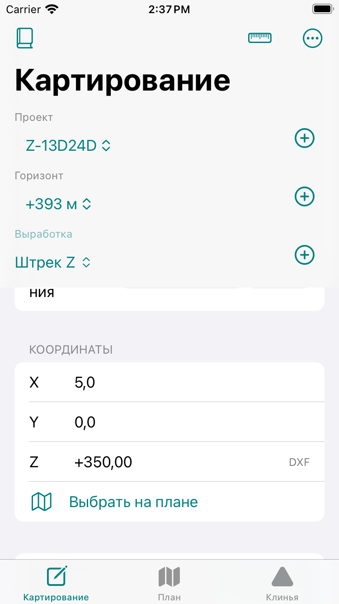
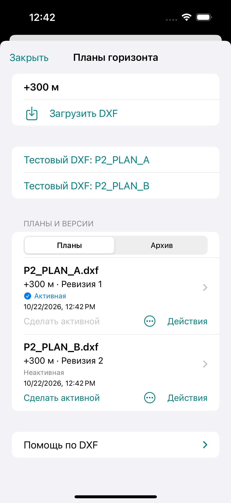
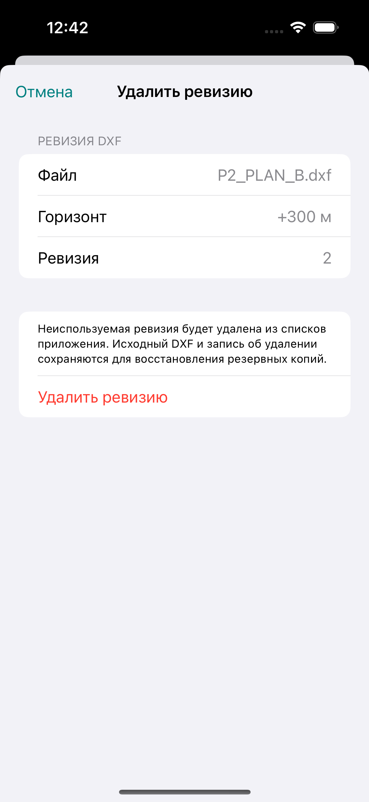
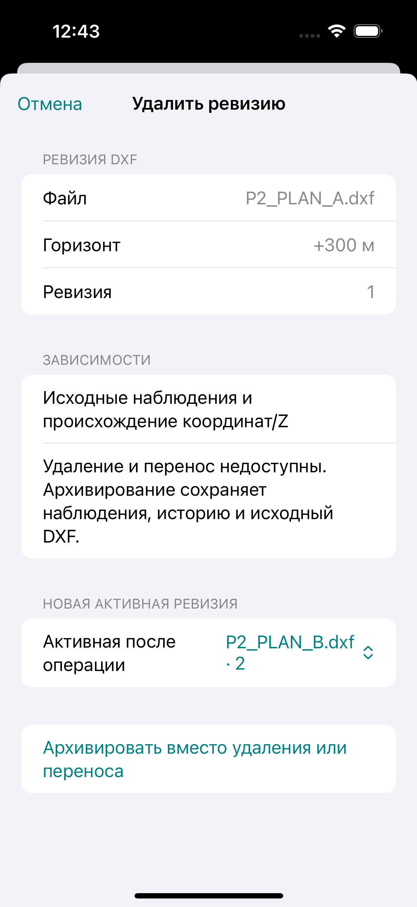
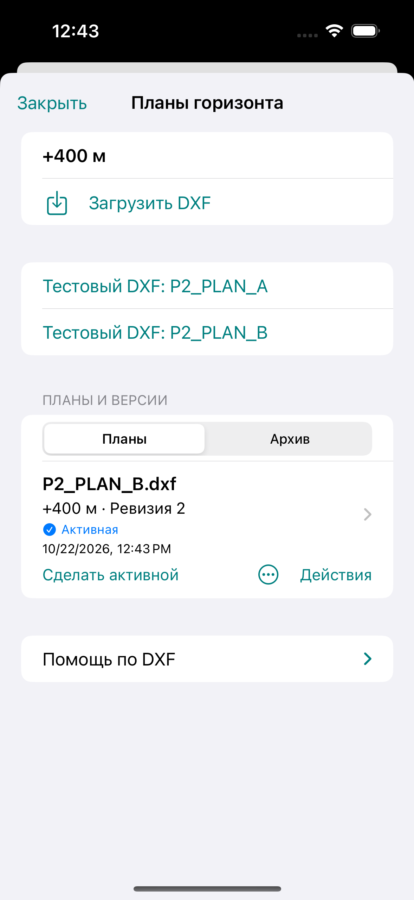

> Current automatic elevation: [nearest-segment algorithm](two-wall-elevation.md). The verification commands/results below are historical and optional reproduction instructions, not routine PR gates; follow [AGENTS.md](../AGENTS.md). No fixture regeneration or independent audit is required for ordinary changes.

# DXF elevation audit and plan revision management

This supersedes the DXF subset and plan-selection details in `p2-dxf.md` and
`gsi-chart-dxf-elevation.md`. Rating methods, GSI and the independent measurement
journal are unchanged. Mapping remains experimental **schema 8**: no migration,
automatic reset or incompatible-schema upgrade is added.

## Audit of PR #58

A further Simulator regression exposed tiny XY near a drawing axis: raw
`String(Double)` produced exponent notation, which the editable decimal input
validator rejected on Save. Plan selection now uses the existing lossless
`ElevationInput.text` decimal expansion for XY. Numerical XY and precision are
unchanged; an independent persistence test protects this path.

The projection/interpolation algorithm and the Mapping callback already carried
accepted DXF Z correctly. The old parser accepted explicit LINE 30/31, 3D POLYLINE
VERTEX 30 and LWPOLYLINE 38, but ignored ordinary POLYLINE header elevation 30 and
all INSERT geometry. Missing Z was deliberately ineligible, including partially
specified LINE endpoints; that rule remains. Unknown/conflicting drawing units
also disabled proposals without a point-specific explanation. Import defaulted
to unknown units, and there was no way to confirm an old import's units for Z.

Independent inspection of the three checked-in original group-code streams found:

| Original fixture | Eligible straight segments | Distance from fitted XY centre to closest elevation segment | Default 2 m search |
| --- | ---: | ---: | --- |
| horizon_200_3d.dxf | 614 | 8.5 m | No candidate |
| horizon_300_3d.dxf | 614 | 8.5 m | No candidate |
| horizon_400_3d.dxf | 290 | 0.7073080051545739 m | Z = 400 m |

These are controls for the supplied fixtures, not a claim about unseen production
files or phone-position accuracy. A plan centre/tunnel interior is not necessarily
near a survey line. File names, text labels and nominal horizon elevation do not
supply geometric Z. A missing proposal preserves the manual value or uses the
existing nominal-horizon fallback; it never invents zero.

## Supported elevation geometry

- LINE: both explicit WCS endpoint elevations (30,31).
- 3D POLYLINE: straight segments with explicit endpoint VERTEX Z (30).
- 2D POLYLINE: explicit **header elevation 30**, with standard extrusion and zero
  dummy VERTEX Z; all vertices receive the header elevation.
- LWPOLYLINE: explicit constant elevation 38, straight segments.
- BLOCK/INSERT: the above straight entities, default extrusion (0,0,1), including
  nested inserts, block base subtraction, XYZ scale, Z-axis degree rotation and
  XYZ insertion translation. Layer 0 inherits the insert layer. Each segment
  retains the insert path, source handle when present and deterministic expanded
  record/segment indices within the hashed original, qualified by extraction version
  `Autodesk-DXF-2018-straight-WCS-blocks/2`. Legacy sources keep their original
  indices and optional fields decode without reinterpretation. XY and Z stay in drawing
  WCS until distance/Z conversion to metres. Absent child Z stays ineligible even
  when an INSERT has an explicit Z offset.

For a local vertex `v`, block base `b`, scales `(sx,sy,sz)`, angle `a` and insertion
`t`, one INSERT applies `t + Rz(a) * diag(sx,sy,sz) * (v-b)`; nested transforms
apply from child to parent. A hand-derived test maps `(1,2,3),(11,2,7)` about base
`(1,2,3)`, scale `(2,3,4)`, angle 90°, insertion `(100,200,10)` to
`(100,200,10),(100,220,26)`. At selected XY `(101,205)`, projection has distance
1 m, parameter 1/4 and Z 14 m. No observation XY is moved.

Bounded limitations: no arbitrary OCS/extrusion transform, INSERT row/column
arrays, external references, cyclic references, mesh/fit/bulge geometry, or text
interpretation. Only straight entities inside blocks are expanded; block labels,
ARC/CIRCLE and other block content are reported as unsupported. Nesting is limited
to eight levels, expanded records to 200,000 and expansion work to 1,000,000 pairs;
existing 10 MB / geometry limits remain. Vertical/zero-length XY edges are excluded.
Explicit zero and negative elevations remain valid. Any missing data stays unknown.

References (version-qualified primary definitions):
[Autodesk DXF 2018 POLYLINE](https://help.autodesk.com/cloudhelp/2018/ENU/AutoCAD-DXF/files/GUID-ABF6B778-BE20-4B49-9B58-A94E64CEFFF3.htm),
[LWPOLYLINE](https://help.autodesk.com/cloudhelp/2018/ENU/AutoCAD-DXF/files/GUID-748FC305-F3F2-4F74-825A-61F04D757A50.htm),
[BLOCK](https://help.autodesk.com/cloudhelp/2018/ENU/AutoCAD-DXF/files/GUID-66D32572-005A-4E23-8B8B-8726E8C14302.htm),
[INSERT](https://help.autodesk.com/cloudhelp/2018/ENU/AutoCAD-DXF/files/GUID-28FA4CFB-9D5E-4880-9F11-36C97578252F.htm).
Closest-point projection remains Ericson (2005), *Real-Time Collision Detection*,
[§5.1.2](https://realtimecollisiondetection.net/books/rtcd/toc/), as documented
in `gsi-chart-dxf-elevation.md`. The 2 m tolerance, 0.1 m similar-distance window
and 0.5 m ambiguity range remain application picking policies, not engineering
risk thresholds or an accuracy claim. Different nearby heights require a choice.

## Diagnostics, old imports and coordinate field

Plan → menu → «Сведения о плане» → «Технические сведения» contains the segment
count, source types (including BLOCK/INSERT), per-reason excluded-entity counts,
source units / $INSUNITS and confirmation status. After a tap it also shows the
selected XY and failure reason, nearest-segment distance when outside tolerance,
or ambiguity. Automatic search is always enabled. Exclusions count unusable entities, not
approximated display chords. A partially usable polyline remains a source if at
least one nondegenerate segment has both explicit elevations.

Every opening re-reads and hash-checks the stored original and runs the current
parser. No geometry cache or reimport is required. New imports use supported
$INSUNITS 6 / 4 automatically and persist `dxfINSUNITS` with metres / millimetres.
Missing, unitless or unsupported declarations require an explicit source-unit
choice during import (`userConfirmedAtImport`); unknown cannot be saved through
the import UI. Supported declarations cannot be contradicted by a manual choice.
Other declarations use the user's explicit metres/millimetres interpretation,
without converting original XY. There is no unit confirmation on the point screen.

Previously unknown units can be confirmed once in plan properties for **new Z
proposals only**, using timestamped `userConfirmedAtPlanReview` metadata. This
never relabels existing XY in `drawing` units, changes CRS, mutates observations
or changes the managed file declaration. Historical imports remain readable.

A tap immediately resolves approximate Z with the unchanged nearest-segment
algorithm. The point screen shows XY, approximate Z or «Z недоступна» and one
«Использовать точку» action, returning to Mapping without another dialog.
Ambiguous geometry remains unavailable; no source picker can bypass it. Manual
Z always survives subsequent point selections (including correction drafts).
Explicitly clearing it permits automatic Z on the next tap. Without a manual
override, a new tap replaces automatic Z or clears it if unavailable. Detailed
provenance remains available from Mapping and plan properties.

Mapping and the correction editor use one editable Z row with a trailing «DXF»,
«Горизонт» or «Вручную», from the actual `ElevationOrigin`. Empty/invalid Z has no
source badge. Display adds a sign and two decimals; focusing reveals the original
unrounded input. Any manual change sets manual provenance, including deliberate
clearing. No separate source row remains. Full existing Z provenance is retained
in records, corrections and existing JSON/CSV/XLSX provenance exports.

## Revisions and data integrity

The list is scoped to the selected horizon and has a separate «Архив» filter.
Each item shows original filename, horizon, revision, import date and status;
«Сделать активной» records an explicit preference. A newly imported revision does
not replace an explicit choice. With no preference, the first available revision
is used; an unavailable explicit choice requires another deliberate selection.
Opening a revision never changes draft coordinates or saved observations.

Import shows the frozen destination horizon, filename, revision and units;
«Подтверждаю горизонт …» is required before saving. The filename never chooses a
horizon. Revision number validation includes available and archived revisions and
pending imports for that horizon. Retired deleted revisions do not reserve a
number, but their UUIDs cannot be reused.

Plan identity, attachment UUID, version, hash and source metadata stay immutable.
The optional `managementHistory` is an append-only list of archive/restore/move/
delete events with timestamp and before/after horizon UUIDs. A move changes only
assignment, within one project, and fails on a revision-number collision.
Storage validates the event chain and source immutability independently of UI.
Old current-schema plan references decode with no management/unit-confirmation
metadata. Observation evidence, corrections, photos and measurements remain
append-only, and ordinary atomic commits preserve `.previous` and external-change
detection.

Delete/move check original observations, every correction snapshot, XY plan links,
DXF Z source links, explicit/qualified compatibility between revisions, and current
or suspended drafts. Dependencies block delete/move and explain why; archive keeps
all links and remains viewable through the filter. Archiving/deleting/moving the
active plan requires explicitly choosing a replacement when alternatives exist.

Deletion is a **permanent retirement from application lists**, after confirmation,
using a retained tombstone rather than unlinking the original. There is no restore
button for deleted items. Original DXF bytes remain in `plans/originals` so the
existing `.previous` journal and offline backups stay recoverable, as required by
the repository's preservation policy. This is intentionally not disk-space
reclamation. Archive has a restore action. No operation deletes observations,
revision history, originals, DXF or backups, and a failed commit publishes no changes.

## Verification

Automated coverage is in `DXFElevationAuditTests`, `PlanElevationSnapTests`,
`PlanRevisionManagementTests` and `P2MappingUITests`. It includes independent XYZ
controls, interpolation, zero/negative/missing Z, radius/ambiguity, units,
reopening existing originals, new Z-only unit confirmation with historical XY,
provenance/manual override, horizon filtering, persisted active choice, safe
retirement/archive/move, history/draft dependencies and failed/external writes.
Execution results and Simulator screenshots are recorded below.

Verified on 2026-10-22 with Xcode 26.6 (17F113):

- `swift test`: **330 tests**, 2 existing opt-in workbook fixtures skipped, 0 failures.
- Xcode Simulator unit suite: **330 tests**, the same 2 opt-in skips, 0 failures.
- iPhone 15 Pro / iOS 17.2 Simulator build and revision UI scenario passed. The UI
  scenario imports two plans, switches active revisions, deletes an unused revision,
  saves a plan-selected observation, refuses its deletion and archives it with an
  explicit active replacement, restores the archive, moves the other revision to
  +400 m and verifies both horizon lists.
- The DXF interpolation / inline-origin / manual-override UI scenario passed on
  iPhone 15 Pro / iOS 17.2. It verifies that the badge has the same row centre as
  the editable Z field and occurs only once. The same scenario passed again on
  **iPhone SE (3rd generation), iOS 17.2**, with the final source build.
- Two deterministic `python3 scripts/generate_project.py` runs yielded the same
  project SHA-256: `402a03f512c209fb27544c02cafd2ca75481f6f1acd7a06f6dde4f3971d8cafd`.
- `git diff --check` passed. Full unrelated UI suites and physical-device / survey
  accuracy testing were not run. No device journals were used or modified.

Simulator evidence uses isolated synthetic projects/imports:

