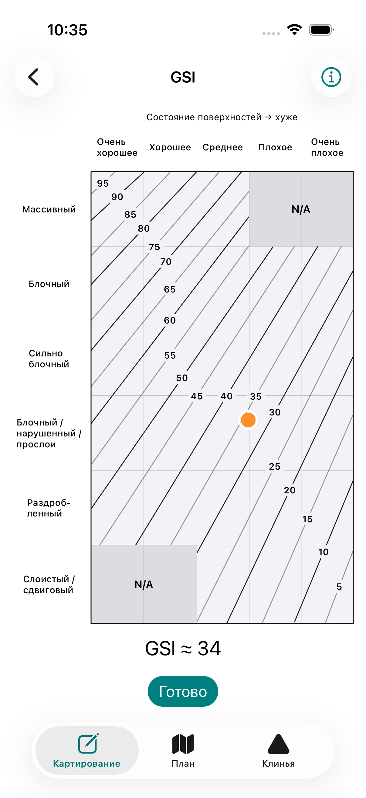
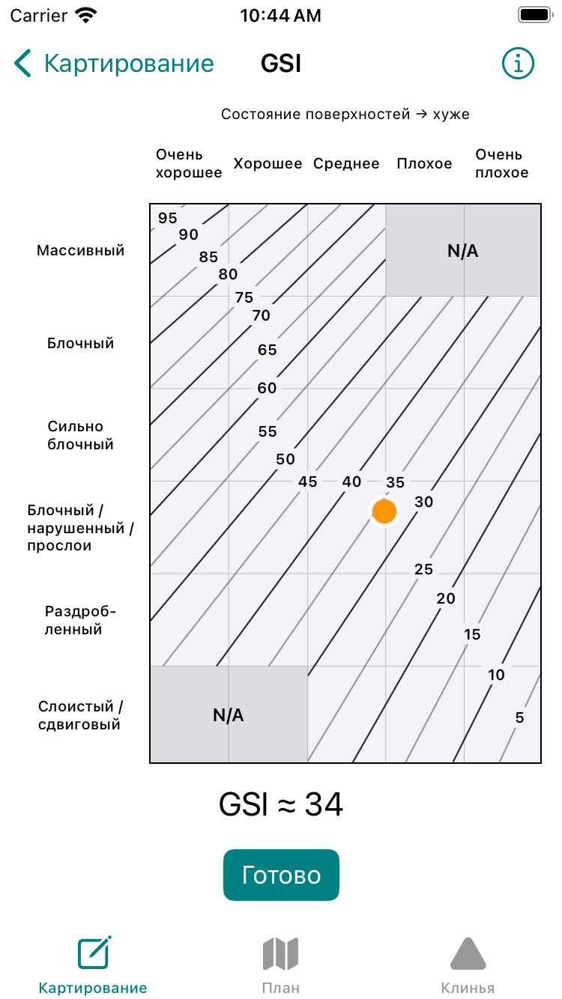
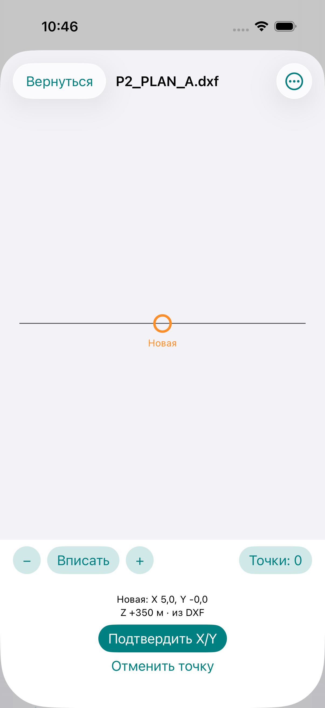

> Current automatic elevation: [nearest-segment algorithm](two-wall-elevation.md). The verification commands/results below are historical and optional reproduction instructions, not routine PR gates; follow [AGENTS.md](../AGENTS.md). Original fixtures and projection controls remain available.

> DXF parsing, unit review, inline Z and plan-management details are superseded by [DXF elevation and plan revisions](dxf-elevation-plan-revisions.md). GSI is unchanged.

# Interactive GSI and DXF elevation suggestions

This supersedes the categorical GSI input and the no-DXF-Z statements in earlier
enterprise/P2 documents. Engineering rating methods Q, RMR89, JCond76 and SD are unchanged.

## GSI source and calibration

Reference: Read & Stacey (eds., 2009), *Guidelines for Open Pit Slope Design*,
§5.4.4, Table 5.34, **printed page 126 / PDF page 141**: Hoek–Brown rock mass
classification system, 2000, modified from Marinos & Hoek (2000).
[Publisher record](https://www.publishing.csiro.au/book/6108).

The owner's `ReadStacey_2009_GuidelinesOpenPitSlopeDesign.pdf` was inspected locally.
SHA-256: `c7af2a3b0e5fdac914414a090c3f273db05b333d97ac941f6c629c5802b43b2a`.
No book page, image, private download URL or copied descriptive artwork is bundled.
The native Canvas uses original typography/layout and factual contour coordinates.

The page is 595 × 765 PDF points. Its numerical plot was rectified to
`x=289.24…445.2165042`, `y=267.216507…524.7326992`, with Y increasing downwards.
The left border has approximately 0.55 pt of drawing skew over the plot height;
rectification and source line endpoints are recorded explicitly. Surface and
structure divisions use the source's actual grid positions, rather than equal
category-centre spacing. `GSIChart` stores the 19 original straight line segments,
deduplicating the two identical paintings in the PDF. Their endpoint coordinates
are preserved to seven decimal PDF points for deterministic reproduction, not as
a claim of geological precision. Display is clipped to the verified applicability outline.

The source labels 90, 80, 70, 60, 50, 40, 30, 20 and 10, and separately labels
the intermediate 75, 55 and 35 lines. Counting the intervening lines calibrates
the five-unit sequence **95, 90, …, 10, 5**. Unlabelled lines are identified by
that sequence; they are not alternative empirical coefficients. The source has
straight contours with varying slopes, not a linear function of category indices.

Verification includes:

1. `scripts/verify_gsi_source.py SOURCE.pdf` independently reads the documented PDF,
   checks its hash/page size, compares all 19 extracted endpoint pairs to production
   data and checks all 12 printed numerical labels. It requires development-only
   `pdfplumber`; the app has no PDF or network dependency.
2. `GSIChartTests.testIndependentSourceContourControls` contains seven separately
   transcribed source-space checkpoints at 90, 80, 75, 55, 50, 35 and 10.
3. A separate MuPDF extraction also found all 19 segments; maximum endpoint difference
   from the stored/pdfplumber coordinates was 0.0000282 PDF points (parser precision).
4. Tests cover interpolation between contours, numerical boundaries, touch/resize,
   applicability boundaries, invalid/extreme positions, persisted exact position,
   timestamps, corrections, categorical compatibility and typed Excel cells.

For a point between consecutive contours, the estimate interpolates by the ratio
of perpendicular distances to those two lines **in the source PDF coordinate frame**.
The corresponding line pair brackets the point; no global X/Y regression, Q/RMR
correlation or categorical approximation is used. Only the resulting estimate is
rounded to an integer and shown as `GSI ≈ n`. This is a digitized geological chart
estimate, not a validated instrument measurement or a stability recommendation.

The chart's conceptual scale remains 0–100. **No 0/100 contours are drawn or
invented**: the small outer corner regions beyond the actual 5/95 contours do not
produce a numerical value. They report «За пределами контуров 5–95» and disable
confirmation. Source N/A areas are massive × poor/very poor and laminated/sheared
× very good/good. General applicability to structurally controlled failures remains
an engineering judgement; the secondary information view preserves that limitation.

## GSI interaction and compatibility

The main screen contains the chart, the integer estimate and «Готово». A
zero-distance drag owns the plot's touch area; there is no surrounding scroll view.
Taps and drags update exact normalized X/Y. Out-of-plot drag updates are ignored;
N/A selections disable confirmation. Attributions and full category descriptions
are in the information sheet. Leaving without confirmation preserves the draft.
Confirming an unchanged position preserves its original assessment timestamp.

`Read-Stacey-2009/table5.34/vector-contours-v1` assessments add optional
`chartPosition` and retain the owning assessment's timestamp, derived integer,
bracketing contours and qualitative categories. Stored `selection.x/y` remain
categorical metadata; **only `chartPosition` is a graphical marker**. Validation
recomputes the derived value/band/categories for this method and rejects mismatches.

Old `categorical-explicit-interval-v1` records retain every original field and
timestamp, and decode without a chart position. Opening one shows its previous
interval without a marker. Only a deliberate new chart selection creates the new
method. Saving a correction retains the old assessment in immutable history.

Ordinary Excel's «Наблюдения» includes numeric GSI, original interval/contour bounds,
method/time and exact normalized position. Relational `assessments.input_json`
retains the full versioned GSI record. Enterprise Excel retains exactly its existing
three worksheets; its GSI value/method/time continue to use the stored assessment,
with X/Y appended to the report. Legacy interval/final values remain exportable.

## DXF segments and units

The parser retains a separate elevation-segment collection, independent of display
paths and untouched original bytes. Source references include entity type, handle
when present, zero-based ENTITIES ordinal and zero-based segment index. Closure
adds a segment without duplicating a source vertex.

| Entity | Eligible elevation | Limits |
| --- | --- | --- |
| 3D POLYLINE | Every segment whose two VERTEX records explicitly contain group 30 | Existing flag/visibility/default extrusion checks apply; partial Z excludes only affected segments |
| LINE | Both endpoint codes 30 and 31 explicitly present, including zero | Differing Z now displays in XY and supports interpolation |
| LWPOLYLINE | Explicit constant elevation group 38 | Straight segments only; default extrusion makes OCS coincide with WCS |
| Other supported entities | No elevation candidates | No arc display chords, POINT, TEXT, layers or filenames are interpreted as elevation references |

Absent Z codes can still default to zero for bounded **display**, but never create
eligible elevation segments. Non-default extrusion, hidden/frozen/invisible/paper
space entities, bulges, meshes and INSERT transforms remain unsupported and warned.
Zero-length XY and vertical segments are excluded: their projected Z is not unique.

Units require the existing explicit `userConfirmedAtImport` declaration. Confirmed
metres use factor 1, millimetres factor 0.001. Declared `$INSUNITS` must agree
(6 / 4 respectively), or be absent/unitless (0). Unknown units, feet/other units or
conflicting declarations disable suggestions. XY stays in original drawing units;
distance, tolerance and proposed Z are in metres. There is no axis/CRS/north/vertical
datum transformation. DXF vertical datum is recorded as **unknown**, never borrowed
from the horizon. Source Z is WCS positive Z under the owner's confirmed frame.

References: [Autodesk LINE and other entity codes, DXF Reference 2014](https://images.autodesk.com/adsk/files/autocad_2014_pdf_dxf_reference_enu.pdf),
[POLYLINE 2018](https://help.autodesk.com/cloudhelp/2018/ENU/AutoCAD-DXF/files/GUID-ABF6B778-BE20-4B49-9B58-A94E64CEFFF3.htm),
[LWPOLYLINE 2018](https://help.autodesk.com/cloudhelp/2018/ENU/AutoCAD-DXF/files/GUID-748FC305-F3F2-4F74-825A-61F04D757A50.htm),
[INSUNITS](https://help.autodesk.com/cloudhelp/2025/ENU/AutoCAD-Core/files/GUID-A58A87BB-482B-4042-A00A-EEF55A2B4FD8.htm).

## XY projection, ambiguity and manual control

The owner-specified algorithm is the standard closest-point-on-segment projection
([Ericson, *Real-Time Collision Detection*, 2005, §5.1.2](https://realtimecollisiondetection.net/books/rtcd/toc/)), applied in WCS XY:

```
d = B.xy - A.xy
t = clamp(dot(P.xy - A.xy, d) / dot(d, d), 0, 1)
Q.xy = A.xy + t*d
distance_m = length(P.xy - Q.xy) * metersPerDrawingUnit
Z_m = (A.z + t*(B.z - A.z)) * metersPerDrawingUnit
```

Candidates must fall within the configured tolerance. The default **2 m** is a
field picking policy, not survey precision. A compact plan menu allows 0.5/1/2/5 m
and disabling automatic proposals. Pure service policies are configurable and
persist with each accepted source. Search occurs once on a new tap/changed policy,
with one projection pass and deterministic sorting of nearby candidates, rather
than on every Canvas draw.

All candidates within **0.1 m** of the closest XY distance are compared. If their
full elevation range exceeds **0.5 m**, no automatic candidate is selected. A small
source picker requires choosing a candidate or explicitly retaining manual/horizon
fallback before confirmation. These thresholds are configurable selection policies,
not geological risk or accuracy thresholds. Same-height duplicates are deterministic.

The orange observation remains at the selected XY; **only Z is proposed**. The
mapping form displays «Z · из DXF», «Z · горизонт» or «Z · вручную» beside its Z field.
Manual Z edits (including deliberate clearing) win. Selecting another point offers
DXF Z while defaulting to retaining a manual value; simply viewing another plan or
changing horizon metadata never changes a saved or manually overridden Z. Existing
legacy nonempty Z with unknown origin is also protected during plan selection.

On deliberate point reselection, stale geometry provenance is cleared. With no
accepted trustworthy candidate, a valid nominal horizon is used; otherwise Z stays
unset. Zero is used only when explicitly supplied by geometry/horizon/manual input.
Manual XY edits keep the frozen sampled-XY provenance of a retained DXF elevation;
they do not secretly resample Z. Its source remains that original sample, while XY
is explicitly `manualInPlan`.

## Persistence and audit

`ElevationOrigin.planGeometry` pairs with `zPlanGeometry`, method
`DXF-WCS-XY-segment-projection/1`. The record freezes plan UUID, revision and SHA-256,
source segment reference/endpoints, selected XY, projection parameter, calculated
Z, XY snapping distance, unit declaration/factor, unknown vertical datum and policy.
Graph validation verifies plan relationships, source metadata and calculation
consistency; stale/wrong-plan suggestions cannot be applied. A manual Z edit clears
computed-source metadata. New plan revisions never rewrite historical sources.

Optional fields extend current experimental schema **8** without migration,
reset or reuse of old schemas. Old observations/revisions decode with nil geometry
metadata and retain their original origin. Current atomic saves, `.previous`,
external-change refusal and append-only evidence/history are unchanged. No original
measurement journal or attachment/recovery behavior is modified. Ordinary/enterprise
Excel expose Z origin, method, revision, distance, unit factor and datum; full export
additionally contains `z_plan_geometry_json`.

## Verification

Core verification: SwiftPM and Xcode Simulator each ran **315 tests, 0 failures,
2 optional external-workbook-fixture skips**. The source audit passed all 19
segments/12 labels; a second PDF parser confirmed the geometry. Simulator build
passed with Xcode 26.6 / iOS 26.5. UI/screenshot results follow below. Tests use
fresh isolated temporary journals and synthetic DXF geometry, plus the existing
three owner-supplied DXF fixtures. No device journal or source book is committed.


Two pre-existing suite failures were corrected in test fixtures only: the three
original-DXF samples now use distinct plan revision numbers and explicitly
separate synthetic CRS names for their isolation test; the Q correction test
asserts preservation of its original frozen method rather than a legacy global
method constant. No Q evaluator or coefficients changed.

Project regeneration is deterministic: SHA-256
`713fd20f15d67267bf3802de87652776590213b6b9436eac9c0b50138716223f`.
No physical measurement accuracy, survey accuracy or complete CAD support is claimed.


`MappingUITests.testGSIChartTapDragRestore` passed on iPhone 17 Pro / iOS 26.5
and iPhone SE (3rd generation) / iOS 17.2. Both screenshots were visually inspected:
all axes, contours, N/A areas, marker, integer estimate and confirmation fit without
scrolling. The test verifies invalid-region refusal and exact marker restoration.

| iPhone 17 Pro | iPhone SE |
| --- | --- |
|  |  |


`P2MappingUITests.testAutomaticDXFElevationAndManualReview` passed on iPhone 17 Pro:
managed DXF import with confirmed metre units, automatic midpoint elevation
(+350 m on a +300…+400 m ramp), unchanged XY, compact source indication, manual
Z override and retention while selecting a different point. Early failures were
in stale UI-test navigation (horizon sheet dismissal, active-plan selection and
formatted field assertions); the final workflow passed.




`MappingUITests.testEnterpriseSDAndGSIInteractiveChartWorkflow` also passed on
iPhone 17 Pro: existing SD entry, direct GSI selection/drag, exact reopening,
observation save and the enterprise Excel share sheet. All four final focused UI
runs passed (GSI on two iPhone sizes, DXF Z review, and the save/export workflow).
