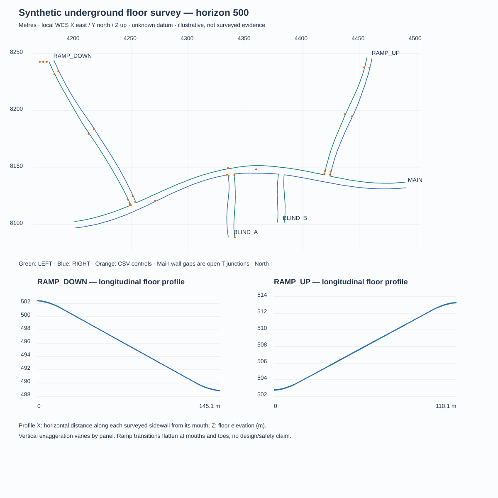
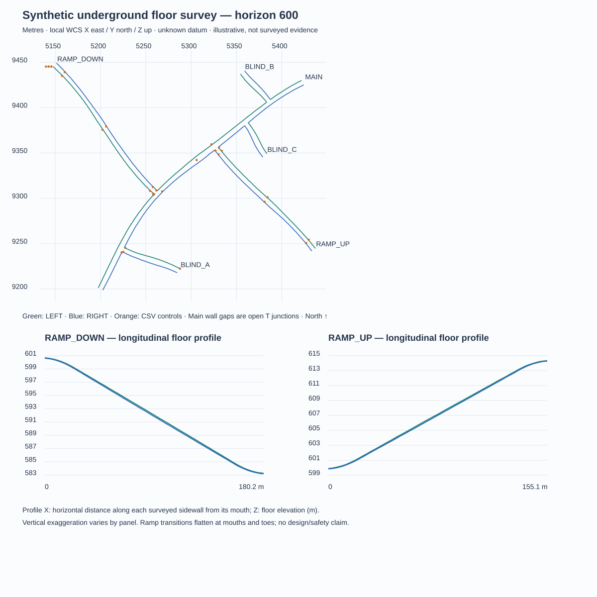
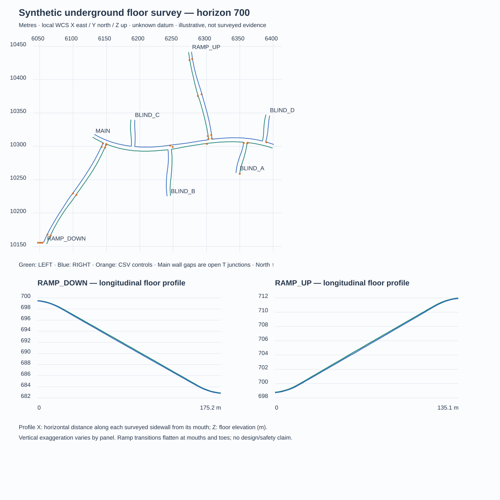

> Current two-wall elevation and plan-tap behavior: [algorithm and verification](two-wall-elevation.md). The nearest-wall/radius and nominal-horizon plan-tap descriptions below are historical. Original fixtures and projection audits are preserved.

# Synthetic underground surveys: horizons 500, 600 and 700

These are independent **synthetic floor surveys**, not measurements from a mine,
excavation designs or evidence of survey/device accuracy. Level names are identifiers.
They do not specify a constant Z. No app algorithms, rating methods, journal formats
or production data are changed by this fixture addition.

## Files and geometry

| Fixture in `Tests/Fixtures/` | Main horizontal length | Branches | Open 3D polylines | Vertices | Actual floor Z range (m) |
| --- | ---: | ---: | ---: | ---: | --- |
| `underground_survey_500.dxf` | 300 m | 4 | 14 | 528 | 488.825011127 … 513.330660000 |
| `underground_survey_600.dxf` | 325 m | 5 | 17 | 653 | 583.203641696 … 614.339270467 |
| `underground_survey_700.dxf` | 275 m | 6 | 20 | 634 | 682.822247881 … 711.985207337 |

500 has an eastward undulating main drift, two northward ramps and two southern
blind headings. 600 has a northeast main drift turning east, five asymmetric
branches, three blind headings and longer ramps. 700 runs westward with six branches, four blind
headings and opposing north/south ramps. All have smooth heading changes,
variable widths, centimetric seeded floor/wall deviations and different grades.
The main centerlines have prescribed grades within approximately −1.5…+1.4%.
Ramp haulage centerline grades are 10.5…11.0%, with 1.5% throats/toes and
changing approach grades. Short surveyed sidewall chords have additional small
floor deviations; tests allow 9.5…12.5% at the haulage control chords. These are
illustrative fixture parameters, not engineering design criteria.

LEFT and RIGHT are relative to **increasing route chainage**, not screen left/right.
Their XYZ values and floor Z deviations are independent. Main sidewalls are split
at T junctions and their endpoints share the branch mouth corner XYZ exactly.
No wall spans an open branch mouth. Blind faces and survey limits remain open;
no artificial closing edge is added. The independent audit finds no proper XY
wall intersections. Short main-wall pieces near a junction can have small Z ranges;
no polyline has constant Z.

Every file is ASCII DXF 2018 (`$ACADVER=AC1032`), `$INSUNITS=6`, with explicit
WCS X/Y/Z at every VERTEX, POLYLINE flag 8, VERTEX flag 32, unique hexadecimal
handles, subclass/owner records and a matching SEQEND. There are no 2D outlines,
block transforms or text-based elevations. The POLYLINE header's dummy coordinate
is zero; **actual elevations are in the VERTEX records**.

Coordinates use a synthetic local right-handed Cartesian grid: X east, Y north,
Z up, all metres. Horizontal CRS and vertical datum are unknown. No alignment,
magnetic/true/grid-north transformation, real mine CRS or GPS location is implied.
Route/profile chainage starts at each route's first sample and increases toward
its end. The preview profiles use horizontal distance **along each sidewall** from
its mouth, so left/right lengths differ slightly from centerline lengths.

## Reproduction

The generator has **no external dependencies** and uses fixed seeds, handles and
nine-decimal source vertices. Those decimals support reproducibility and testing;
they are not a survey-accuracy claim. It writes only these named synthetic fixtures,
controls, manifest and SVGs; `--check` never writes.

```sh
python3 scripts/generate_underground_surveys.py
python3 scripts/generate_underground_surveys.py --check
python3 scripts/generate_project.py
swift test
```

The checked-in manifest records source hashes, counts, Z extrema and control
outcomes. Literal SHA-256/count controls also live in `UndergroundSurveyTests.swift`.
The existing original-owner DXFs and their independent tests remain unchanged.

For an independent audit, use a disposable environment; ezdxf is a developer-only
parser dependency, never an app/generator/Swift-test dependency:

```sh
python3 -m venv /tmp/ff-survey-audit
/tmp/ff-survey-audit/bin/pip install ezdxf==1.4.4
/tmp/ff-survey-audit/bin/python scripts/audit_underground_surveys.py
```

The generator's oracle resolves nearest segments through unit-tangent/normal
coordinates, separately from the app. The auditor reads **committed DXF bytes**
with ezdxf 1.4.4 and checks the CSV using 50-digit Decimal projection, without
importing the generator or FieldForge. Raw handle uniqueness is checked before
parsing; audit errors/fixes and proper wall crossings must all be zero.

## Control-point contract

Each `underground_survey_NNN_controls.csv` has **30 controls** (90 total):
left/right main walls; both sides of both ramps at approach, haul and toe;
a clamped blind-face endpoint; six branch-mouth samples; two parent-wall samples;
a shared junction corner; exact 2/5 m, just beyond 2/5 m and 8 m offsets; and a
point at the center of a widened main drift.

Columns:

| Columns | Meaning |
| --- | --- |
| `case`, `tap_x`, `tap_y`, `expected_z` | Original tap XY and interpolated floor Z of the nearest eligible geometry |
| `nearest_layer`, `nearest_handle`, `segment_index` | Source 3D polyline and zero-based source segment index |
| `a_x`, `a_y`, `a_z`, `b_x`, `b_y`, `b_z` | Explicit endpoints independently verifiable in the DXF |
| `t`, `distance_xy_m` | Clamped interpolation parameter and planar distance in metres |
| `projected_x`, `projected_y` | Nearest point on geometry; these **must not replace tap XY** |
| `default_2m_status` | `automatic` or `outside_tolerance` under the existing default policy |

`expected_z` exists even on refused samples: it is an audit answer for the nearest
geometry, **not** a claim that FieldForge automatically supplies it at that distance.
“Nearest 3D polyline” means nearest in XY; tap Z is not known in advance. It is not
minimum XYZ distance. Z is linearly interpolated at that XY projection.

At exact shared corners both walls have identical XYZ, so a tie cannot change Z.
Source ties resolve by the existing entity order/segment-index policy (main walls
are serialized before branches). Distinct-height ambiguous intersections remain
covered by existing `PlanElevationSnapTests`; these connected single-level floor
fixtures intentionally contain no overlapping overpasses.

## Z results and distance limitation

All **90 controls** agree with the independent audit; maximum absolute discrepancy
across distance, parameter and Z is below **1.1 × 10⁻¹²** (floating arithmetic,
not physical precision). Test comparison tolerance is 10⁻⁸ m for distance/Z.
Ezdxf reports zero errors and zero fixes for all files. Eligible segment counts
are 514, 636 and 614, respectively.

Each file has **25 automatic proposals and 5 explicit refusals** at the default
2 m tolerance. Exact 2 m succeeds; 2.0001, 5, 5.0001 and 8 m fail. With the existing
5 m option, 2.0001 and exact 5 m succeed; 5.0001 and 8 m still fail. A 20 m
service policy is used only in audit tests to compare the unrestricted nearest
answer for every control; it does not change the app default or menu.

| Wide main drift center | Nearest wall distance | Audit Z (m) | Default result |
| --- | ---: | ---: | --- |
| 500 | 3.3315798061231803 m | 502.537435959 | No DXF proposal |
| 600 | 3.4395053284996875 m | 600.2091506888586 | No DXF proposal |
| 700 | 3.1020136308094500 m | 699.2225380261807 | No DXF proposal |

This is a real limit of the existing picking policy: an interior point in a
wide excavation can be too far from either surveyed sidewall. The service reports
“Ближайший высотный сегмент дальше допуска … м” and the nearest distance. Geometry
has not been narrowed to make these controls pass. The existing workflow can use
an explicitly marked nominal-horizon fallback or a manual value; that value must
not be reported as a DXF-derived Z.

Tests retain tap XY through proposal acceptance for all controls and through
managed original import, current-schema save and reopen for both renamed copies
of each file. The same bytes named `underground_survey_999.dxf` or `no_level.dxf`
still produce the ramp's Z under a deliberately unrelated nominal horizon **+393**.
An 8 m refusal preserves XY and leaves the existing +393 fallback explicitly
labelled `horizonDefault`, with no geometry provenance. No filename or level
number supplies geometry Z.

## Previews

Equal-scale top views show left/right walls, open junctions and CSV controls.
Each SVG also contains separate longitudinal profiles of both ramp sidewalls;
vertical exaggeration varies by panel and is explicitly noted.







## Verification

- SwiftPM: **336 tests, 0 failures, 2 existing optional workbook-fixture skips**.
- Six new test methods exercise all three fixtures and all 90 controls.
- Xcode 26.6 / iPhone 17 Pro Simulator iOS 26.5: app build passed; **336 core tests, 0 failures, 2 existing optional skips**.
- Both generator byte checks and two consecutive Xcode project generations passed.
  Project SHA-256: `ea680bd2d2767decefada4588c852010983d9dd9073afc3b5068ef9df4469a9a`.
- All three final SVGs were rendered and visually inspected for clipping, layouts,
  connected mouths and changing floor profiles. No physical-device/sensor test was needed.

## References and scope

The unchanged production geometry method is `DXF-WCS-XY-segment-projection/1`,
using the existing extraction version `Autodesk-DXF-2018-straight-WCS-blocks/2`.
References: Ericson, *Real-Time Collision Detection* (2005),
[§5.1.2, Closest Point on Line Segment to Point](https://realtimecollisiondetection.net/books/rtcd/toc/);
Autodesk DXF 2018 [POLYLINE](https://help.autodesk.com/cloudhelp/2018/ENU/AutoCAD-DXF/files/GUID-ABF6B778-BE20-4B49-9B58-A94E64CEFFF3.htm)
and [VERTEX](https://help.autodesk.com/cloudhelp/2018/ENU/AutoCAD-DXF/files/GUID-0741E831-599E-4CBF-91E1-8ADBCFD6556D.htm).
See the existing [projection, units and ambiguity contract](gsi-chart-dxf-elevation.md#xy-projection-ambiguity-and-manual-control)
and [current DXF/revision behavior](dxf-elevation-plan-revisions.md).
No rock-mechanics equations, GSI, RMR, Barton Q or stability assessments are added
or modified. Synthetic grade/width/noise choices are scenario parameters only.
